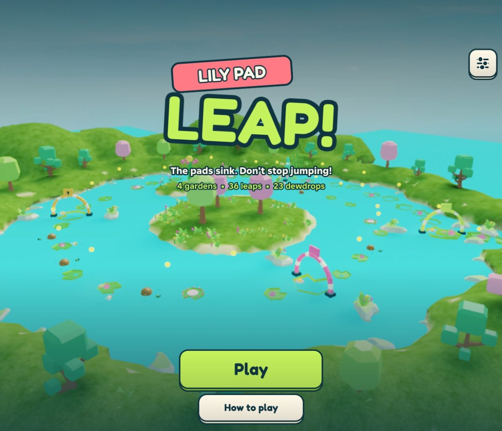
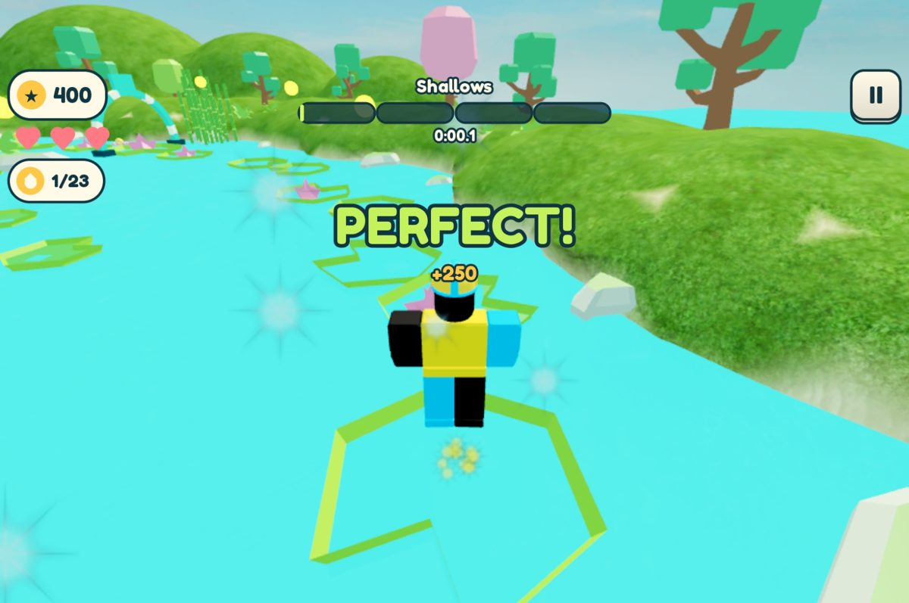
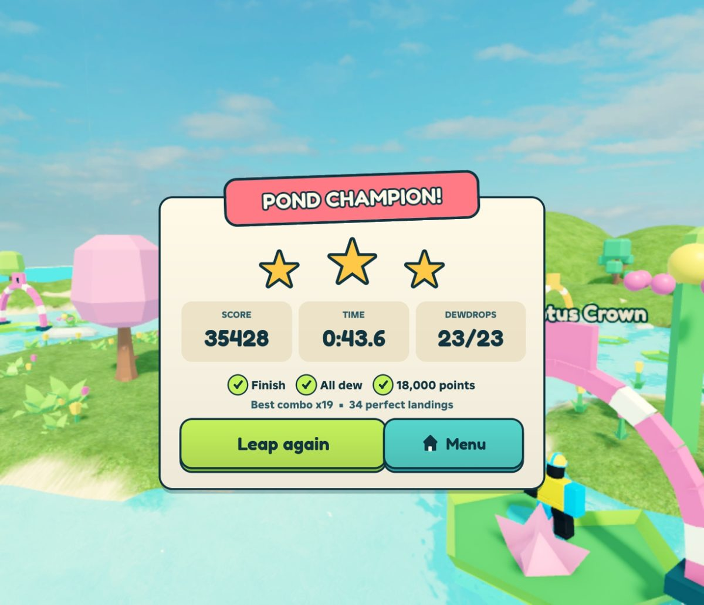

# Roblox Gamesmith

**An agent skill for making whole Roblox games, not just scripts.** Give Claude Code (or Codex) an
idea, and it researches the genre, designs a mechanic that's actually fun, builds the world and
systems as real files, drives Roblox Studio in the background, playtests with bots that play like
people, looks at its own screenshots, and hands you a game that works on a phone.

<p align="center">
  
  
  
</p>
<p align="center"><sub>Lily Pad Leap: built, bot-tested and UI-toured with this skill. What it proved is in <code>references/reference-game.md</code>.</sub></p>

## Quick start

```bash
git clone https://github.com/ishsharm0/roblox-gamesmith.git ~/roblox-gamesmith
cd ~/roblox-gamesmith && ./install.sh
```

Then in Roblox Studio, open any place and turn on **Enable Studio as MCP server** (Assistant panel ->
`...` -> Manage MCP Servers). Open a new terminal and ask your agent:

> Make me a Roblox game where you guide a paper boat down a storm drain, dodging debris. Use the
> roblox-gamesmith skill.

`install.sh` sets up the Roblox toolchain (Rojo, Selene, StyLua, Lune via Rokit), links the skill into
`~/.claude/skills` (`--agent codex` or `--agent both` for Codex), puts the tools on your PATH, caches
the official Roblox docs, and runs `rbxgame doctor` to check everything.

**Requirements:** macOS, Roblox Studio (signed in), Python 3.9+, git. The installer gets the rest.

## What it does differently

Most AI Roblox help writes a script and stops. This skill carries a game the whole way and holds it
to a bar: *would a player pick it over the genre's top ten?*

- **Fun is designed, then measured.** The skill makes the agent build a core verb that has a judgement
  in it (timing, distance, aim), lay the course out beat by beat with a difficulty curve, and add
  stakes and a score. Then two bots play it: a precise one (can it be finished?) and one that makes a
  person's mistakes (where does it get unfair?). In the test game, that second bot found a
  difficulty wall, a hazard that was pure luck, and a forced-failure timing bug. All three were fixed
  before any human played.
- **It looks at its own work.** Camera contact sheets, UI tours that click through every screen on
  desktop and a simulated iPhone, and captures of key moments. Claims come with evidence.
- **Files, not a Studio-only place.** Code in `src/`, the world in `.rbxm` files, Rojo builds the place.
  Everything is diffable, reviewable and in git.
- **Studio stays out of your way.** It runs hidden in the background through Studio's own built-in MCP
  server. No plugin to install, no window stealing focus.
- **The official docs, offline.** `rbxdocs` searches Roblox's documentation and API reference
  ([Roblox/creator-docs](https://github.com/Roblox/creator-docs)), refreshed weekly, so the agent
  checks facts instead of guessing at APIs.
- **Production rules built in:** server authority and remote validation, session-locked saves,
  idempotent purchases, free-model audits, phone-first UI, performance budgets, and an honest
  "what wasn't tested" in every handoff.

## What's inside

```
SKILL.md                 the router: rules, tools, and which file to read for which task
workflows/               make-a-game (the full process), debug, audits, publish
references/              31 focused guides: mechanics & fun, player journey, level design, art
                         direction, game feel, UI/UX, Luau, architecture, security, data, monetization,
                         performance, testing, Studio MCP, assets, audio, combat, inventory, ...
templates/project/       what `rbxgame new` copies: Rojo layout, UiKit design system, Poser animation,
                         a human-model bot harness, Lune tests
templates/genres.md      playbooks for obby, simulator, tycoon, RPG, horror, battle royale
tools/                   rbxgame, studio, rbxdocs, rbx-research, yt-research, devforum, rbxcloud
```

## The tools

| Command | What it does |
|---|---|
| `rbxgame new <dir>` | scaffold a project (Rojo layout, UI kit, animation module, lint config, tests) |
| `rbxgame open` / `push` / `save` | open hidden in Studio, hot-reload code, export the world back to files |
| `rbxgame check` | Selene + StyLua + Lune unit tests |
| `rbxgame test <scenario>` | play, run a scenario on the server, report, stop |
| `rbxgame shots` / `tour` | camera contact sheets; click-through UI tours on desktop and phone |
| `rbxgame doctor` | check the setup and say how to fix gaps |
| `studio luau/shot/play/console/...` | any Studio MCP tool from the shell |
| `rbxdocs api/find/search/read` | the official Roblox docs and API reference, offline |
| `rbx-research`, `yt-research`, `devforum` | what's working on Roblox, gameplay videos, DevForum answers |
| `rbxcloud` | upload assets with your own Open Cloud key (preview first, never spends Robux) |

All tools work without an agent too: `rbxgame --help`, `rbxdocs --help`.

## Using it with other agents

The skill is plain Markdown plus command-line tools, so any agent that can read files and run shell
commands can use it. Claude Code and Codex load it as a skill automatically. For others, point the
agent at `AGENTS.md`.

## Try it

```bash
rbxgame new ~/rbx/first-game --name "First Game"
cd ~/rbx/first-game && rbxgame open    # opens hidden in Studio
rbxgame check                          # lint + rule tests
```

Or just ask your agent for a game; it runs these for you.

## FAQ

**Does it publish my game or spend Robux?** No. The skill forbids publishing, creating products or
spending without your explicit go-ahead for that action. Asset uploads need your own Open Cloud key
and show a preview first.

**Windows?** Not yet. The Studio tools drive the macOS app. The references and `rbxdocs` work anywhere.

**Does it use AI-generated art?** Not by default. It builds from parts, terrain, Blender meshes, CC0
kits and vetted Creator Store assets. Studio's generation tools are used only if you ask for them.

**Studio isn't connecting.** Run `rbxgame doctor`. Studio must be open with a place, with the MCP
server toggle on. See `references/studio-mcp.md`, "Troubleshooting".

**Can I use it on an existing game?** Yes. Ask the agent to inspect the place
(`references/studio-mcp.md`, "Inspect someone else's place") and move it into files.

## Contributing

Issues and pull requests are welcome; see [CONTRIBUTING.md](CONTRIBUTING.md). The most valuable
contributions are verified lessons: a pitfall you hit (with the fix) for `references/sharp-edges.md`,
or a mechanic pattern proven in a real game.

## License and credits

MIT. See [LICENSE](LICENSE) and [NOTICE](NOTICE). `rbxdocs` downloads Roblox's
creator documentation (CC-BY-4.0) to your machine at first use; it is not included in this repository.
Roblox and Roblox Studio are trademarks of Roblox Corporation. This project is not affiliated with
or endorsed by Roblox.
