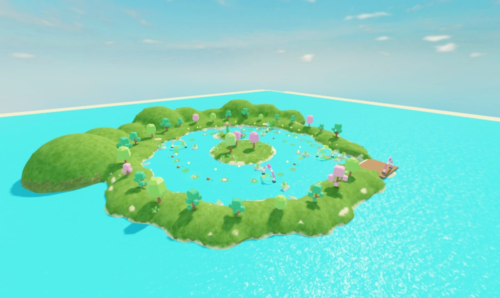

# Patterns from a tested game (Lily Pad Leap)

Lily Pad Leap was built end to end with this skill and tested by bots, scenarios and UI tours. It's a
charge-and-leap game across sinking lily pads in four gardens. Its screenshots are in `docs/images/`.
The game itself isn't in this repository; what it proved is here, as patterns to copy.



## Design as data

The whole course is a table in `src/shared/Config.luau`. Changing difficulty is a data edit, and the
builders, the server and the client all read the same numbers.

```lua
Stages = {
	{ name = "Shallows", radius = 5.2, sinkDelay = 2.0, preview = "full",
	  beats = { { 9, "pad", 0 }, { 13, "pad", 2 }, { 12, "pad", -2 }, { 16, "pad", 1 }, ... } },
	{ name = "Petal Peak", radius = 3.6, sinkDelay = 1.0, preview = "none", bud = 4,
	  beats = { { 14, "pad", 0 }, { 18, "drift", 2 }, { 13, "turtle", -2 }, ... } },
}
-- a beat = { gap (centre to centre, studs), kind, sideways offset }
```

The curve is in the columns: pads shrink (5.2 -> 3.6), sink faster (2.0 -> 1.0 s), the landing guide
fades (full arc and ring -> arc -> half arc -> none), and each garden adds one new kind (bounce,
drift, turtle). A layout module turns beats into positions once (`Layout.compute()`), and a scenario
asserts every leap is in reach and no pads overlap. That check caught two pads overlapping by 0.4
studs.

## Server state, published as attributes

A per-player table on the server, published as player attributes with `Phase` set last
(`architecture.md`). Phases are Lobby, Tutorial, Ready, Countdown, Run, Results, as a pure transition
table in `src/shared/Flow.luau` with Lune tests. There is one request remote (`Action`: Begin, Skip,
Restart, Menu, Rescue) and one feedback remote (`Feedback`: Land, Splash, Checkpoint, Bud, Bounce),
whose events carry only what the client needs to animate.

Star rules, progression and best-time rules are pure functions in `shared/` and are used by the server,
the HUD and the tests alike. A star rule that was duplicated in the HUD drifted from the server's.

## The core verb: charge and leap

Hold to charge, and a meter swings 0 -> 1 -> 0 (a triangle wave, so holding too long costs you).
Release to leap a distance set by the charge:

```lua
local function triangle(x: number): number
	local k = x % 2
	return if k <= 1 then k else 2 - k
end
charge = triangle((os.clock() - chargeStart) / 0.85)
local dist = 4 + 28 * charge -- MinDistance + (MaxDistance - MinDistance) * charge

-- exact ballistic launch: lands `dist` away after T seconds, whatever the gravity
local T = 0.42 + dist * 0.012
root.AssemblyLinearVelocity = dir * (dist / T) + Vector3.new(0, 0.5 * workspace.Gravity * T, 0)
```

What made it feel right:
- The Humanoid goes into the `Physics` state for the flight (air control otherwise brakes the leap),
  held upright by an `AlignOrientation`.
- Landing is a lookahead raycast against pads only, and only while descending.
- A 0.35 s input buffer: a press just before touchdown starts the charge on landing.
- After each landing, and after every respawn, the camera turns to frame the next target.
- The client counts its own landing for aiming. Server-published progress lags ~0.3 s; a press in
  that gap used to aim at the pad underneath and hop in place (on a pad that sinks after 1 s, a lost
  heart). The server still decides progress.
- Procedural poses (`procedural-animation.md`): crouch while charging, stretch on take-off, tuck in
  the air, a flip on long leaps, squash on landing.

## Aim assist that leads moving targets

The player chooses distance and the game chooses direction (the next pad within an 80° cone of the
camera). For moving pads the assist must aim where the pad will be:

```lua
-- each frame: smoothed velocity of the next target
local v = (target - last) / dt
track.vel = track.vel:Lerp(v, math.clamp(dt * 12, 0, 1))
-- at launch: lead by the flight time
target += track.vel * (0.42 + dist * 0.012)
```

Without the lead, a drifting pad was luck rather than skill: 60% of casual leaps failed there. With it,
31% did.

## Stakes without walls

- Score: Good 100 / Perfect 250 (inside 40% of the radius), times a combo multiplier
  (1 + 0.25 x streak, capped at 4), plus dewdrops on the arcs and a time bonus.
- Three hearts. A splash costs a heart and the combo, each lotus checkpoint refills one, and losing all
  three adds 10 s.
- Stars: finish, every dewdrop, and a score set from bot data (a precise bot scores ~32-42k and
  casual human-model runs 12-19k, so the third star is 18k).
- A splash respawns you at the garden's lotus, or at its **bud** once reached. The bud is a halfway
  pad that never sinks. Without buds the last garden was a wall: ten beats at ~80% each meant about 1
  clean pass in 9, and some casual runs looped 20-30 times.
- Fairness: the pad before a turtle holds through a whole dive cycle plus a leap. When it held for
  2.6 s, a badly timed landing forced a splash.

## The test hook and the bots

The client exposes a `BindableFunction` that drives the real controls:

```lua
hook.OnInvoke = function(arg)
	if arg == "busy" then
		return flight ~= nil or os.clock() < bounceUntil or not grounded()
	end
	return LeapWithCharge(arg) -- the same launch() a key press uses
end
```

Then:
- A **precise bot** that measures each gap and leaps with the exact charge. It must finish every time
  (it does in ~45 s with 0 splashes).
- A **human-model bot** (`templates/project/scenarios/human-bot.luau` is the generic harness) adding
  judgement, timing and reaction error. Casual profile, 4 runs, fixed seed: every run finishes in
  ~50-75 s, with splashes per garden about 0 / 0 / 1 / 5.
- **Probes** that repeat one beat with exact or deliberately offset inputs. These measured the real
  landing tolerance (about ±3 studs on a 3.6-radius pad), and they proved one "hot spot" was the bot
  reading the world before a respawn finished, not a game bug.
- **Server scenarios** that teleport to isolate rules: a skipped checkpoint is rejected, landings
  count in order, pads sink, rescue works, saves round-trip, receipts are idempotent. Teleport
  scenarios must respect moving hazards too: wait for a turtle's safe window, let a bounce finish, and
  drop the character inside the landing band on a drifting pad.

## UI

One ScreenGui from `UiKit` (`ui-ux-style.md`), with screens chosen by `Phase`. Two bugs only the tour
caught:
- the title said "17 dewdrops" after the course changed to 23. Counts shown in UI are now computed
  from the course data.
- a simulated phone tap missed the Skip button, so the tour never left the tutorial. Tours now fall
  back to firing the remote after a click.
